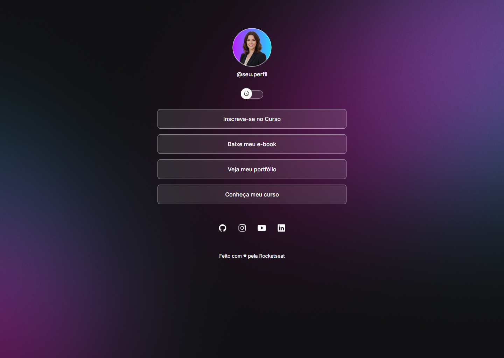
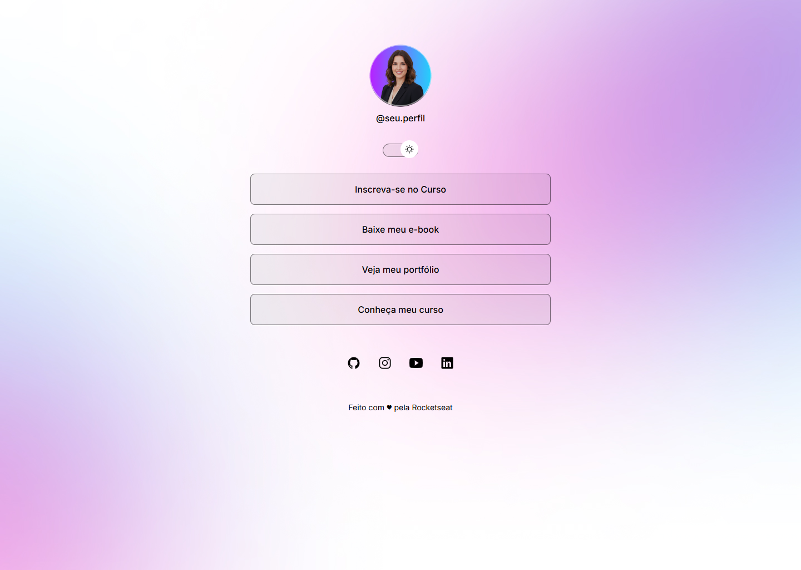
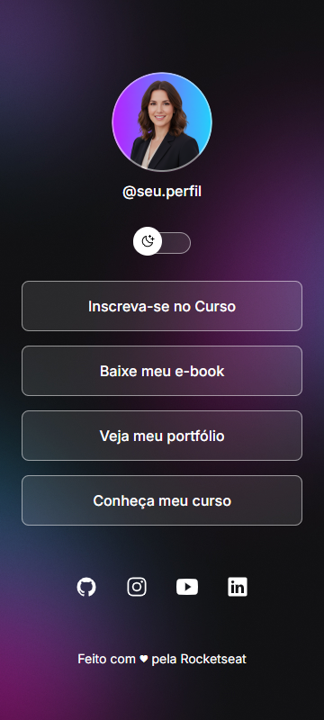
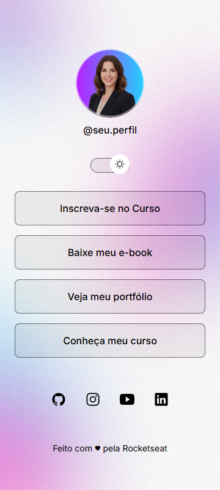

# DevLinks

Página de links pessoais desenvolvida com React e Vite, reproduzindo as referências
desktop e mobile do Figma. A aplicação possui alternância entre os temas escuro e
claro, com a preferência salva no `localStorage`.

## Stack

- React 19
- Vite
- JavaScript
- CSS puro com design tokens
- Fonte Inter

## Como executar

Pré-requisito: Node.js instalado.

```bash
npm install
npm run dev
```

Abra o endereço exibido pelo Vite (normalmente `http://localhost:5173`).

Para gerar a versão de produção:

```bash
npm run build
npm run preview
```

Para verificar o código com ESLint:

```bash
npm run lint
```

## Estrutura

```text
src/
├── App.jsx                 # composição da página, dados e estado do tema
├── App.css                 # layout do perfil, botões, redes sociais e rodapé
├── index.css               # tokens de cor, fundos, reset e tipografia
└── components/
    ├── Profile.jsx         # avatar e identificação
    ├── ThemeToggle.jsx     # alternância de tema acessível
    ├── LinkButton.jsx      # botão reutilizável dos links principais
    ├── SocialLinks.jsx     # redes sociais renderizadas com map()
    └── icons.jsx           # ícones SVG
public/
└── img/
    ├── avatar.png
    ├── bg-desktop.png
    ├── bg-desktop-light.png
    ├── bg-mobile.png
    └── bg-mobile-light.png
tests/
└── devlinks.spec.js          # testes end-to-end com Playwright
docs/
├── prints/                   # prints do site publicado (desktop e mobile)
└── evidencias/               # provas das consultas e execuções das ferramentas
```

## Como testar

```bash
npm run test:e2e
```

Os testes usam Playwright com o Chrome já instalado no computador
(`channel: 'chrome'`), então não é preciso baixar navegadores. O Vite sobe
automaticamente e os cenários rodam em `1440 × 1024` e `360 × 800`.

## Prints

Capturas do site publicado em `https://devlinks-sigma-eight.vercel.app/`.

### Desktop — 1440 × 1024





### Mobile — 360 × 800





## Links e redes sociais

Os destinos ficam centralizados em `src/App.jsx`, nos arrays `links` e
`socialLinks`. Para trocar um destino, altere apenas o valor de `href`.

Redes sociais preenchidas:

- GitHub: `https://github.com/Devpaulo1`
- LinkedIn: `https://www.linkedin.com/in/devpaulo1/`
- YouTube: `https://www.youtube.com/@KillRockts`
- Instagram: `https://www.instagram.com/rocketseat/` (destino público provisório)

Os links principais de curso, e-book e portfólio também usam destinos públicos
provisórios indicados pelo responsável. Substitua-os quando as URLs definitivas
forem definidas.

`LinkButton` e `SocialLinks` adicionam automaticamente `target="_blank"` e
`rel="noopener noreferrer"` quando o `href` começa com `http://` ou `https://`.

O rodapé contém o texto definido pelo responsável do projeto:
`Feito com ♥ pela Rocketseat`, com link para o site da Rocketseat.

## Tema

- O tema escuro é o padrão.
- O botão de tema usa `role="switch"` e `aria-checked` para expor o estado atual.
- A preferência é salva em `localStorage` na chave `devlinks-theme`.
- Um script inline em `index.html` aplica o tema salvo antes do React carregar,
  evitando o flash de tema incorreto.

## Evidências das ferramentas

As provas de uso das ferramentas ficam em `docs/evidencias/`:

- **Context7** — [`docs/evidencias/context7.md`](docs/evidencias/context7.md):
  consulta real à documentação oficial do React sobre `useState`, `useEffect` e
  `localStorage`, com data, endpoint e resposta bruta em
  [`context7-react-raw.txt`](docs/evidencias/context7-react-raw.txt).
- **Playwright** — [`docs/evidencias/playwright.md`](docs/evidencias/playwright.md):
  execução dos testes end-to-end, com a saída do terminal em
  [`playwright-run.txt`](docs/evidencias/playwright-run.txt) e capturas geradas
  pelos próprios testes.

## Validação realizada

- `npm run build`: concluído sem erros.
- `npm run lint`: concluído sem avisos ou erros.
- `npm run test:e2e`: **6 testes aprovados** (3 cenários × 2 viewports).
- Navegador: página carregada sem erros no console e sem requisições com falha.
- Lighthouse: 100 em acessibilidade, boas práticas e SEO.
- Viewports verificados: `1440 × 1024` (desktop) e `360 × 800` (mobile), nos temas
  escuro e claro, sem rolagem horizontal.
- Alternância de tema testada por clique e por teclado (`Enter`).
- Persistência testada após recarregar a página: o tema claro permaneceu ativo e
  `data-theme="light"` foi restaurado.
- Ordem de foco por `Tab`: botão de tema, quatro links principais, quatro redes
  sociais e link do rodapé, todos com foco visível.
- Comparação de layout com o frame desktop do Figma: avatar de 112 px, container
  de 588 px, botões de 56 px com 16 px de intervalo, ícones sociais de 24 px e
  rodapé alinhados às referências.

### Limitações

- O ambiente não tem os MCPs de Context7 e Playwright configurados no OpenCode.
  Por isso as evidências foram geradas com a API pública do Context7 e com o
  pacote oficial `@playwright/test`, que são as mesmas fontes usadas pelos MCPs.
- O texto do rodapé do frame do Figma estava ambíguo na renderização/OCR. Foi
  usado o texto definido pelo responsável do projeto.
- Os links de curso, e-book, Instagram e o link do rodapé usam destinos públicos
  provisórios, conforme autorizado pelo responsável do projeto.
